# `cmdtrace` — Command Impact Predictor

> `cmdtrace` analyzes a shell command and explains its likely impact and risk before you run it.

**Team:** Om M Rane , Jitesh Vishwakarma  
**Repository:** https://github.com/Ompro24/LInux-Command-Assignment    
**Date:** 27-10-2026

---

## 1. The problem

When working in the terminal, it is easy to run a command without fully understanding which files or directories it may affect. `cmdtrace` is intended to help users inspect potentially risky commands before executing them. The examples and evidence below must be checked against our actual workflow before submission.

### What we keep doing by hand

A user may inspect a command manually, check its help page, and inspect the target path before deciding whether to run it. For example:

```bash 
pwd
ls -la
mkdir -p ./temp
ls -la ./temp
```
```

**Important:** Do not run a destructive example just to collect evidence. Use a harmless test directory if you need to demonstrate file-related behavior.

### Evidence that this is real

Run the following on your own machine and replace the placeholder with your real output. This sample checks how often `rm` appears in your shell history; it does not prove that every occurrence was risky.

```bash
ls -la ./temp
```

```Output
total 0
drwxr-xr-x   2 om  staff   64 Oct 28 08:45 .
drwxr-x---+  XX om  staff  XXX Oct 28 08:45 ..
```


**How often and what it costs:** [I sometimes need to check terminal commands before running them, especially when I am unsure which files or directories they may affect. This takes extra time because I need to read the command, check its options, and inspect the target path to avoid making unwanted changes.]

### Who else has this problem

[I discussed this problem with one of my MCA classmates. They mentioned that they also check unfamiliar terminal commands before running them because they want to understand what the command will do and avoid accidental changes.]

---

## 2. Prior art — what already exists

Existing tools already provide command explanations and shell-script analysis. We tested three tools through their websites to understand their capabilities and compare them with our proposed `cmdtrace` tool.

### Tools we found and actually tried

| Tool | Where we found it | What it does | Why it may not solve our problem |
|---|---|---|---|
| ShellCheck | [Official website](https://www.shellcheck.net/) and [GitHub repository](https://github.com/koalaman/shellcheck) | Identifies common mistakes and potential issues in shell scripts. | It focuses on shell-script analysis rather than providing a complete impact report for an individual command. |
| `tldr` | [Official website](https://tldr.sh/) and [GitHub repository](https://github.com/tldr-pages/tldr) | Provides concise explanations and practical examples of terminal commands. | It helps users understand command syntax but does not primarily focus on assessing the specific target and risk of a supplied command. |
| ExplainShell | [Official website](https://explainshell.com/) and [GitHub search](https://github.com/search?q=explain-shell&type=repositories) | Breaks down shell commands and explains their components using manual-page information. | It focuses on explaining command syntax; our proposed tool aims to provide a concise report of the likely action, target, and risk before execution. |

**Testing note:** We explored these tools through their websites. We did not install and run them from the terminal during these tests. Any differences described above should be confirmed against the actual behavior observed during testing before final submission.
### Evidence of trying them

We tested three existing tools through their websites to understand their functionality and compare them with our proposed `cmdtrace` tool.

**ShellCheck — https://www.shellcheck.net/**

Test script:

```bash
#!/bin/sh
name="Om"
echo $name
```

ShellCheck was used to investigate potential issues in shell scripts. We also examined a script containing `rm -rf "$HOME/temp"` to investigate whether it identified potential deletion-related issues.

**tldr — https://tldr.sh/**

We looked up examples of the `rm` command to understand its syntax and options. The tool provides concise explanations and practical examples that help users understand terminal commands.

**ExplainShell — https://explainshell.com/**

Test command:

```bash
rm -rf ./temp
```

We used ExplainShell to investigate how it breaks down a shell command and explains its individual components, including command options and arguments.

**What the tools got right and what was missing:**

ShellCheck helps identify common shell-script mistakes, tldr provides practical command examples, and ExplainShell explains command syntax. Our proposed `cmdtrace` aims to analyze a supplied command and provide a concise report of its likely action, target, and risk before execution. This proposed difference needs to be validated against the actual results observed during testing.

**Note:** These tools were tested through their websites; they were not installed and run from the terminal during these tests. If terminal-based evidence is required, we will need to install and test the relevant tools separately.

### Where we searched

- [ ] GitHub search — searched for shell-command explanation tools, command safety tools, and related projects.
- [ ] `man -k safety` — search the local manual pages for relevant command-safety tools.
- [ ] Homebrew: `brew search shellcheck` — check available command-line tools for shell-script analysis.
- [ ] ShellCheck website — [https://www.shellcheck.net/](https://www.shellcheck.net/) — explored shell-script analysis and potential warnings.
- [ ] tldr website — [https://tldr.sh/](https://tldr.sh/) — explored concise command explanations and usage examples.
- [ ] ExplainShell website — [https://explainshell.com/](https://explainshell.com/) — explored how shell commands and their arguments are explained.
- [ ] Stack Overflow — search for discussions about understanding command impact and preventing accidental file changes.
- [ ] npm / PyPI — search for existing command-line tools or libraries related to command analysis and safety.
- [ ] Asked a human: [Add the classmate's name or role and their actual response after asking them about this problem.]


### The gap, in one sentence

Existing tools can identify shell-script mistakes, provide command examples, and explain command syntax, but `cmdtrace` aims to combine command-specific action identification, target-path information, and risk warnings in one concise report before execution, without executing the command.
---

## 3. What we are building

### In scope

- Accept a shell command as a quoted string, such as `cmdtrace "rm -rf ./temp"`.
- Identify a limited, documented set of supported commands and flags.
- Explain the likely action, target path, and risk level using readable output.
- Warn when a command appears to delete or overwrite data, and clearly state when analysis is incomplete.
- Never execute the analyzed command; the first version is an inspection-only tool.

### Out of scope

- **Executing commands automatically:** `cmdtrace` will only analyze and explain commands. It will never execute, delete, move, or modify files because this keeps the tool safe to use.
- **Supporting every possible shell command:** The initial version will support only selected commands, such as `rm`, `mv`, `cp`, `ls`, and `pwd`. Complex commands, pipelines, aliases, and shell scripts may not be analyzed reliably, so unsupported inputs will be clearly identified.
- **Guaranteeing complete safety:** `cmdtrace` will provide an estimated risk level based on predefined rules. It cannot guarantee that a command is safe in every environment or predict every possible side effect.
- **Using external AI services or APIs:** The initial version will use local Python logic and predefined rules to keep the tool simple, lightweight, and usable without an internet connection.

### How we will know it worked

This tool is successful if it converts a manually inspected shell command into one concise impact report showing the command's likely action, target, risk level, and warning before execution. We aim to correctly classify at least 20 documented test cases, including harmless, potentially destructive, invalid, and unsupported commands. The tool must never execute the command being analyzed, and we will consider the project successful if our team finds it useful for understanding commands and avoiding accidental changes even after the assignment ends.
---

## 4. Tech stack

| Choice | What we picked | Why, and what we rejected |
|---|---|---|
| Language | Python 3 | The team can build and test a CLI quickly with readable code. A compiled language is unnecessary for the first version. |
| Argument parsing | Python `argparse` | It is included with Python and supports help text and argument validation. A third-party parser is unnecessary for a small CLI. |
| Other dependencies | Python standard library initially | Avoids extra installation steps. Add a dependency only if a specific requirement justifies it. |
| Testing | `unittest` | Included with Python and sufficient for testing known commands, unsupported input, and malformed arguments. |
| Packaging / install method | Clone the repository and run with `python3`; optionally add an executable entry point later | Simple for a student project and easy to reproduce. A published package is outside the first version's scope. |

### Why this language

We chose Python because it is readable and suitable for a small command-line application. It provides argument parsing, text processing, and unit-testing support in its standard library, which helps us keep the initial version small. We considered Bash, but Python will be easier to organize as the number of command patterns and test cases grows.

### What we are deliberately not using

We are not using pure Bash for the main implementation because maintaining command parsing and test logic in a large shell script may become difficult. We are also avoiding a large framework or external AI service in the first version so the tool remains lightweight and predictable.

---

## 5. Architecture

The `cmdtrace` tool follows a simple four-stage architecture. It accepts a shell command as input, parses and analyzes it using predefined Python rules, and displays an impact report. The tool does not execute the command being analyzed.

```mermaid
flowchart TD
    A[User enters command] --> B[Parse arguments]
    B --> C{Valid input?}
    C -->|No| D[Display error or usage]
    C -->|Yes| E[Analyze command]
    E --> F[Identify action and target]
    F --> G[Assign estimated risk]
    G --> H[Display impact report]
    D --> I[Exit]
    H --> I
```



### Components

| Part | Responsibility | File |
|---|---|---|
| Command-line interface | Accepts the command string and handles arguments and errors. | `cmdtrace.py` |
| Command analyzer | Recognizes supported commands and identifies their likely actions and targets. | `cmdtrace.py` |
| Risk assessment | Assigns an estimated risk level and generates a warning using predefined rules. | `cmdtrace.py` |
| Test suite | Checks supported commands, risk classifications, and invalid inputs. | `test_cmdtrace.py` |

These components are initially implemented or planned within the same Python file, with tests in a separate file.

### Data flow

The user supplies a shell command as a quoted string through the command-line interface. Python parses the input, checks it against predefined rules, and determines the likely action, target, and estimated risk level. The program prints an impact report to the terminal without executing the supplied command or modifying the filesystem.

### What happens when things go wrong

| If this happens | The tool does this |
|---|---|
| No command is supplied or the arguments are invalid. | Displays usage instructions or an error message. |
| The command contains invalid quotation marks. | Reports that the input could not be parsed and asks the user to check the syntax. |
| The command is not supported. | Displays an `UNKNOWN` risk level and warns that the command has not been analyzed. |
| The command contains complex syntax or ambiguous targets. | Warns that the analysis may be incomplete instead of claiming the command is safe. |

## 6. Usage

### Synopsis

```bash
python3 cmdtrace.py [options] "command to inspect"
```

### Commands and flags

| Flag | Long form | What it does | Default |
|---|---|---|---|
| `-h` | `--help` | Displays usage instructions and exits. | — |
| `-v` | `--verbose` | Reserved for future detailed analysis output; not implemented yet. | Off |
| — | — | The command to analyze must be provided as a quoted argument. | Required |

**Note:** The initial version does not need a `--dry-run` flag because `cmdtrace` only analyzes the supplied command and never executes it. This ensures that the tool does not perform the actions it describes.

### Examples

The following examples show the expected behavior of the current prototype. Replace the sample output with the actual output from your terminal after running the program.

**Basic use**

```bash
python3 cmdtrace.py "pwd"
```

```text
=== cmdtrace: Command Impact Report ===
Command: pwd
Action:  Inspect the current directory or its contents
Target:  Current directory
Risk:    LOW
Warning: No file changes are expected from this command.
Execution: Not performed.
```

**With a potentially destructive command**

```bash
python3 cmdtrace.py "rm -rf ./temp"
```

```text
=== cmdtrace: Command Impact Report ===
Command: rm -rf ./temp
Action:  Delete files or directories
Target:  ./temp
Risk:    HIGH
Warning: Deletion may be difficult or impossible to undo.
Execution: Not performed.
```

**When it fails**

```bash
python3 cmdtrace.py --nonsense
```

```text
usage: cmdtrace.py [-h] command
cmdtrace.py: error: unrecognized arguments: --nonsense
```

The exact error text may vary depending on the implementation and Python version.

### Exit codes

| Code | Meaning |
|---|---|
| 0 | The command was analyzed and a report was produced. |
| 1 | An analysis or runtime error occurred. |
| 2 | Invalid arguments or command-line usage error. |

### Installation

```bash
git clone <your-repository-url>
cd <your-repository-directory>
python3 cmdtrace.py --help
```

Replace the repository placeholders with your actual GitHub repository URL and directory name. Python 3 must be installed. The installation instructions should be tested after the code is committed to the repository.

### Exit codes

| Code | Meaning |
|---|---|
| 0 | The input was analyzed and a report was produced. |
| 1 | The input could not be analyzed reliably or another runtime error occurred. |
| 2 | Invalid arguments or command-line usage error. |

Implement and test these exit-code meanings before treating them as final.

### Installation

After the project is committed to the team's repository, a user can run:

```bash
git clone <your-repository-url>
cd <your-repository-directory>
python3 --version
python3 cmdtrace.py --help
```

The last command will work after `cmdtrace.py` has been implemented. Replace the repository placeholders with the actual URL and directory. If dependencies are added later, document their installation here and test the instructions on another machine.

---

## 7. References

- [Python `argparse` documentation](https://docs.python.org/3/library/argparse.html) — command-line arguments and help messages.
- [Python `unittest` documentation](https://docs.python.org/3/library/unittest.html) — unit testing with the standard library.
- [ShellCheck](https://www.shellcheck.net/) — candidate shell-script analysis tool to install and test.
- [tldr pages](https://tldr.sh/) — candidate source of concise command examples; install and test a CLI implementation before describing it as tested.
- [GitHub repository search for shell command explainers](https://github.com/search?q=shell+command+explanation&type=repositories) — identify a third comparable tool, then record the exact repository and test results.

**Before submission:** Replace every bracketed placeholder, collect your own terminal evidence, test at least three existing tools, update all example outputs with actual output, and make sure the final claim about the gap matches what you observed.
