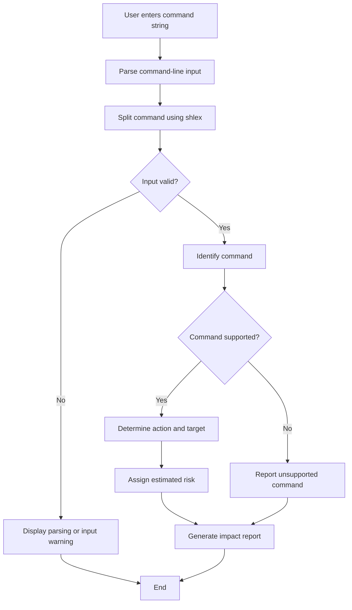

# `cmdtrace` — Command Impact Predictor

> `cmdtrace` analyzes shell commands and explains their likely action, target, and risk level before the user runs them.

**Team Members:** Om M Rane, Jitesh Vishwakarma  
**Repository:** https://github.com/Ompro24/LInux-Command-Assignment  
**Date:** 28 October 2026

---

## 1. Problem Statement

### Problem

Users often execute terminal commands without fully understanding their effects. Some commands only display information, while others can move, overwrite, or permanently delete files and directories. An unfamiliar command or incorrect file path can cause unwanted changes.

Users may need to search online, read documentation, or inspect command options before running unfamiliar commands. This takes time and may still leave them uncertain about the command's impact.

### Proposed Solution

`cmdtrace` is a Python command-line tool that analyzes a shell command supplied as text and generates a command impact report.

The report includes:
- The command entered by the user.
- The likely action performed by the command.
- The identified target or command arguments.
- An estimated risk level.
- A warning about possible consequences.

The tool does not execute the supplied command. It uses predefined analysis rules to classify supported commands.

### Example Problem Scenario

A user wants to inspect the following command:

```bash
rm -rf ./temp
```

Instead of executing it immediately, the user can pass it to `cmdtrace` for analysis:

```bash
python3 cmdtrace.py "rm -rf ./temp"
```

The tool is designed to identify the deletion operation, classify it as high risk, and display a warning before the user decides whether to run the original command.

### Why This Project Is Useful

- Helps users understand unfamiliar terminal commands.
- Highlights potentially destructive operations.
- Provides a simple command impact report.
- Encourages users to review commands before execution.
- Demonstrates Python programming, command-line interfaces, input parsing, and unit testing.

---

## 2. Prior Art and Existing Solutions

Before developing `cmdtrace`, we considered existing tools that help users understand or validate shell commands.

| Tool | Purpose | Difference from `cmdtrace` |
|---|---|---|
| ShellCheck | Identifies common issues in shell scripts. | `cmdtrace` focuses on analyzing individual command strings and estimating their impact. |
| tldr | Provides concise examples and explanations of command usage. | `cmdtrace` aims to produce an action, target, and risk report for supported commands. |
| ExplainShell | Explains the components of shell commands. | `cmdtrace` aims to classify command risk and provide warnings in addition to identifying the likely action. |

### Existing Tools

- ShellCheck: https://www.shellcheck.net/
- ShellCheck repository: https://github.com/koalaman/shellcheck
- tldr: https://tldr.sh/
- tldr repository: https://github.com/tldr-pages/tldr
- ExplainShell: https://explainshell.com/

### Project Gap

These tools provide useful functionality for shell-script checking, command examples, and command explanations. `cmdtrace` focuses on a different, narrower task: generating a concise impact report with an estimated risk level before a command is executed.

The current prototype uses predefined rules rather than artificial intelligence or a complete shell parser.

---

## 3. What We Are Building

### Project Overview

We are building `cmdtrace`, a Python-based command-line application that accepts a shell command as a string and analyzes it without executing it.

The program parses the input, identifies supported commands, determines their likely action and target information, assigns an estimated risk level, and displays a warning when appropriate.

### Main Features

1. **Command Input:** Accepts a command string from the terminal.
2. **Command Parsing:** Uses Python's `shlex` module to split the supplied command into parts.
3. **Action Identification:** Identifies the likely operation for supported commands.
4. **Target Identification:** Extracts relevant command arguments.
5. **Risk Classification:** Assigns a predefined risk level.
6. **Warning Messages:** Displays warnings about possible consequences.
7. **Unsupported Command Handling:** Reports commands that do not have analysis rules.
8. **Unit Testing:** Uses Python's `unittest` framework to check expected behavior.

### Commands Supported by the Initial Prototype

| Command | Likely Action | Estimated Risk |
|---|---|---|
| `pwd` | Inspect the current directory | LOW |
| `ls` | List directory contents | LOW |
| `rm` | Delete files or directories | HIGH |
| `mv` | Move or rename files | MEDIUM |
| `cp` | Copy files | MEDIUM |

### Scope

**In scope:**
- Analyzing individual command strings.
- Identifying supported commands and their likely actions.
- Displaying target information and risk warnings.
- Handling empty input and parsing errors.
- Testing the analyzer with predefined test cases.

**Out of scope:**
- Executing commands automatically.
- Supporting every possible shell command.
- Fully interpreting complex shell syntax, pipelines, aliases, variables, and wildcards.
- Guaranteeing that a command is safe.
- Replacing the operating system's shell or security tools.

### Success Criteria

The project will be considered successful when:
- Supported commands produce the expected impact report.
- Potentially destructive commands receive appropriate warnings.
- Unsupported commands are not automatically treated as safe.
- Unit tests verify important analyzer behaviors.
- The tool consistently avoids executing the supplied command.

---

## 4. Technology Stack

| Technology | Purpose |
|---|---|
| Python 3 | Main programming language |
| `argparse` | Handles command-line arguments and help information |
| `shlex` | Splits command strings into tokens |
| `unittest` | Tests the command analyzer |
| Git and GitHub | Version control and source-code hosting |
| VS Code | Development environment |

### Why Python?

Python provides a simple way to build command-line applications and includes standard-library modules for argument parsing, string processing, and automated testing. This allows the initial prototype to be developed without requiring external packages.

### Project Files

| File or Directory | Purpose |
|---|---|
| `cmdtrace.py` | Contains the main command analyzer and command-line interface |
| `test_cmdtrace.py` | Contains automated unit tests |
| `__pycache__/` | Python-generated cache directory; it is not source code required for the project |

---

## 5. Architecture

### Architecture Diagram



### Main Components

**1. Command-Line Interface**

Accepts the command string from the user and displays the analysis report.

**2. Command Parser**

Uses `shlex.split()` to split the command string into a command name and arguments. Parsing errors are handled without executing the input.

**3. Command Analyzer**

Checks the command name against predefined rules for supported commands, such as `pwd`, `ls`, `rm`, `mv`, and `cp`.

**4. Risk Classification**

Assigns a predefined risk level according to the identified command. The classification is an estimate and does not guarantee safety.

**5. Report Generator**

Displays the original command, likely action, target, risk level, warning, and execution status.

**6. Unit Tests**

The `test_cmdtrace.py` file checks whether the analyzer returns expected results for selected inputs.

### Data Flow

1. The user supplies a command string.
2. The program parses the input.
3. The command name and arguments are identified.
4. The analyzer applies the corresponding predefined rule.
5. The program prepares an impact report.
6. The report is displayed without executing the original command.

---

## 6. Usage

### Prerequisites

- Python 3 installed.
- Git installed if cloning the repository.
- A terminal or VS Code terminal.

### Installation

Clone the repository and navigate into the project directory:

```bash
git clone https://github.com/Ompro24/LInux-Command-Assignment.git
cd LInux-Command-Assignment
```

### Command Syntax

```bash
python3 cmdtrace.py "command to analyze"
```

Enclose the command in quotation marks so that the program receives it as a single input string.

### Example 1: Analyze the Current Directory Command

**Input:**

```bash
python3 cmdtrace.py "pwd"
```

The program identifies the likely purpose of the command and displays its estimated risk level.

### Example 2: Analyze a File-Movement Command

**Input:**

```bash
python3 cmdtrace.py "mv file.txt ./temp/"
```

**Sample Output:**

```text
=== cmdtrace: Command Impact Report ===
Command: mv file.txt ./temp/
Action:  Move or rename files
Target:  file.txt, ./temp/
Risk:    MEDIUM
Warning: Files may be moved or overwritten.
Execution: Not performed.
```

This output is based on the current prototype's observed behavior.

### Example 3: Analyze a File-Deletion Command

**Input:**

```bash
python3 cmdtrace.py "rm -rf ./temp"
```

The program is designed to identify the deletion operation, classify it as high risk, and display a warning about potentially irreversible deletion.

The command is analyzed as text and is not executed by `cmdtrace`.

### Example 4: Analyze an Unsupported Command

**Input:**

```bash
python3 cmdtrace.py "git status"
```

If the command is unsupported, the program reports that it cannot analyze the command and assigns an unknown risk level.

### Displaying Help

Run:

```bash
python3 cmdtrace.py --help
```

This displays the usage information provided by the command-line argument parser.

### Running Unit Tests

Run the automated tests using:

```bash
python3 -m unittest -v test_cmdtrace.py
```

The current test file checks:
- Whether `pwd` receives a low-risk classification.
- Whether `rm` receives a high-risk classification.
- Whether an empty command receives an unknown-risk classification.

A test passes when the actual result matches the expected result.

### Limitations

- Risk levels are estimates and are not guarantees of safety.
- Complex shell syntax may not be interpreted correctly.
- Target identification is based on basic argument parsing.
- Unsupported commands require additional analysis rules.
- The tool does not execute commands or modify files.

---

## 7. References

1. Python Documentation — `argparse`: https://docs.python.org/3/library/argparse.html
2. Python Documentation — `shlex`: https://docs.python.org/3/library/shlex.html
3. Python Documentation — `unittest`: https://docs.python.org/3/library/unittest.html
4. ShellCheck: https://www.shellcheck.net/
5. ShellCheck GitHub Repository: https://github.com/koalaman/shellcheck
6. tldr Pages: https://tldr.sh/
7. tldr GitHub Repository: https://github.com/tldr-pages/tldr
8. ExplainShell: https://explainshell.com/
9. Project Repository: https://github.com/Ompro24/LInux-Command-Assignment

---

**Project Note:** `cmdtrace` is an initial prototype intended for educational use. Its output depends on predefined rules and basic command parsing. Users should independently verify commands before executing them.
