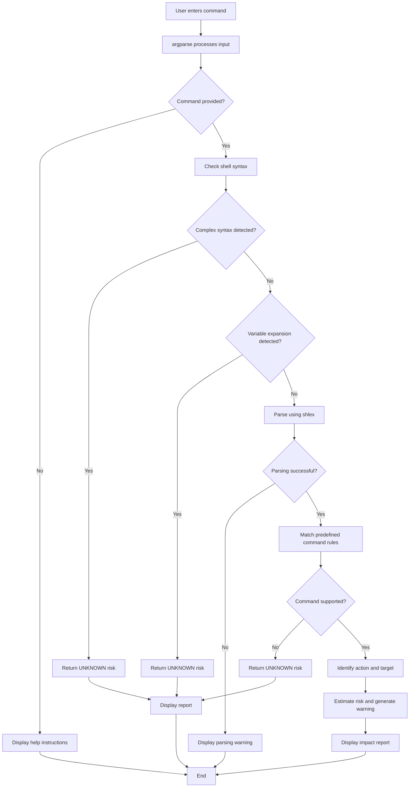

# `cmdtrace` — Command Impact Predictor

> `cmdtrace` is a Python command-line tool that analyzes shell command text and predicts its likely action, target, risk level, and potential consequences without executing the supplied command.

**Team Members:** Om M Rane, Jitesh Vishwakarma  
**Repository:** https://github.com/Ompro24/LInux-Command-Assignment  
**Date:** 28 October 2026

---

## Table of Contents

1. [Problem Statement](#1-problem-statement)
2. [Prior Art and Existing Solutions](#2-prior-art-and-existing-solutions)
3. [Project Overview and Features](#3-project-overview-and-features)
4. [Technology Stack](#4-technology-stack)
5. [Architecture](#5-architecture)
6. [Installation and Usage](#6-installation-and-usage)
7. [Testing](#7-testing)
8. [Limitations and Future Scope](#8-limitations-and-future-scope)
9. [Team Members](#9-team-members)
10. [References](#10-references)

---

## 1. Problem Statement

### Problem

Users frequently execute terminal commands without fully understanding their effects. Some commands only display information, while others can move, overwrite, change permissions, or permanently delete files and directories.

An unfamiliar command, an incorrect file path, or an unexpected command-line option can cause unwanted changes to files or the system.

Users may need to consult documentation, search online, or inspect command options before executing unfamiliar commands. This takes time and may still leave them uncertain about the potential impact.

### Proposed Solution

`cmdtrace` is a Python-based command-line application that analyzes a shell command supplied as text and generates a command impact report.

The report includes:

- The original command supplied by the user.
- The likely action associated with the command.
- The identified target or relevant arguments.
- An estimated risk level.
- A warning describing possible consequences.
- A statement confirming that the supplied command was not executed.

The application uses predefined Python rules to analyze supported commands. It does not execute the command being analyzed.

### Example Problem Scenario

Consider the following command:

```bash
rm -rf ./temp
```

This command can recursively remove the specified directory and its contents. The `-f` option can suppress certain prompts and errors.

Instead of executing the command immediately, a user can analyze it first:

```bash
python3 cmdtrace.py "rm -rf ./temp"
```

The application identifies the likely deletion operation, assigns a high estimated risk, and displays a warning.

### Why This Project Is Useful

- Helps users understand unfamiliar terminal commands.
- Highlights potentially destructive operations.
- Provides a concise command impact report.
- Encourages users to review commands before execution.
- Demonstrates Python programming, command-line interfaces, input parsing, rule-based analysis, and unit testing.

---

## 2. Prior Art and Existing Solutions

Before developing `cmdtrace`, we considered existing tools that help users understand or validate shell commands.

| Tool | Purpose | Difference from `cmdtrace` |
|---|---|---|
| ShellCheck | Identifies common issues in shell scripts. | `cmdtrace` focuses on analyzing individual command strings and estimating their impact. |
| tldr | Provides concise examples and explanations of command usage. | `cmdtrace` aims to produce an action, target, and risk report for supported commands. |
| ExplainShell | Explains the components of shell commands. | `cmdtrace` focuses on estimating risk and presenting warnings alongside the likely action. |
| `man` pages | Provide detailed documentation for commands and their options. | `cmdtrace` aims to provide a short, structured summary rather than replacing detailed documentation. |

### Existing Tools

- ShellCheck: https://www.shellcheck.net/
- ShellCheck repository: https://github.com/koalaman/shellcheck
- tldr: https://tldr.sh/
- tldr repository: https://github.com/tldr-pages/tldr
- ExplainShell: https://explainshell.com/

### Project Gap

Existing tools provide useful functionality for shell-script checking, command examples, detailed documentation, and command explanations.

`cmdtrace` focuses on a narrower task: generating a concise impact report with an estimated risk level before the user decides whether to execute a command.

The current implementation is rule-based. It does not use artificial intelligence or a complete shell parser.

---

## 3. Project Overview and Features

### Project Overview

`cmdtrace` accepts a command as a string, examines its structure, matches supported commands against predefined rules, and generates a readable impact report.

The application considers command names, selected options, and target arguments when assigning risk levels. It also identifies certain forms of complex shell syntax that it cannot reliably analyze.

### Main Features

1. **Command Input:** Accepts command text through the terminal.
2. **Command-Line Interface:** Uses `argparse` to handle input and provide help and version information.
3. **Command Parsing:** Uses Python's `shlex` module to tokenize simple command strings.
4. **Action Identification:** Identifies the likely operation for supported commands.
5. **Target Identification:** Extracts relevant command arguments.
6. **Risk Classification:** Assigns an estimated risk level using predefined rules.
7. **Context-Aware Rules:** Considers selected options and targets for commands such as `rm`, `mv`, `cp`, and `chmod`.
8. **Warning Messages:** Displays warnings about possible consequences.
9. **Unsupported Command Handling:** Reports `UNKNOWN` when no matching rule is available.
10. **Complex Syntax Detection:** Flags certain pipelines, redirection, command chaining, and variable expansion for manual review.
11. **Parsing Error Handling:** Reports invalid quotation or parsing problems.
12. **Unit Testing:** Uses Python's built-in `unittest` framework to check expected behavior.

### Commands Covered by the Current Rules

| Command | Likely Action | Typical Estimated Risk |
|---|---|---|
| `pwd` | Display the current directory | LOW |
| `ls` | List directory contents | LOW |
| `cat` | Display file contents | LOW |
| `grep` | Search text | LOW |
| `find` | Search for files and directories | LOW or HIGH, depending on action options |
| `rm` | Remove files or directories | MEDIUM or HIGH |
| `mv` | Move or rename files | MEDIUM or HIGH |
| `cp` | Copy files or directories | MEDIUM or HIGH |
| `mkdir` | Create directories | LOW |
| `touch` | Create files or update timestamps | LOW |
| `chmod` | Change file permissions | MEDIUM or HIGH |
| `chown` | Change file ownership | HIGH |
| `sudo` | Run a command with elevated privileges | HIGH for recognized commands |
| `kill`, `killall`, `pkill` | Send signals to processes | HIGH |
| `apt`, `apt-get`, `brew`, `pip`, `pip3` | Manage software packages | MEDIUM or HIGH |
| `curl`, `wget` | Transfer data over a network | MEDIUM |
| Unsupported commands | No matching analysis rule | UNKNOWN |

**Note:** These are approximate rule-based classifications, not guaranteed descriptions of every possible command behavior. The risk assigned depends on the rules implemented in the current version.

### Risk Classification

| Risk Level | Meaning |
|---|---|
| LOW | The recognized operation is generally informational or has a limited expected impact. |
| MEDIUM | The operation may modify files, software, or system state. |
| HIGH | The operation may be destructive, affect many files, change security permissions, or use elevated privileges. |
| UNKNOWN | The application cannot confidently assess the supplied command. |

A risk level is an estimate, not a guarantee of safety. Even a command marked LOW can have unexpected consequences in a particular environment.

### Project Scope

**In scope:**

- Analyzing individual command strings.
- Recognizing predefined command rules.
- Identifying likely actions and target arguments.
- Estimating risk and displaying warnings.
- Handling empty input and parsing errors.
- Flagging selected forms of complex shell syntax.
- Testing analyzer behavior with automated unit tests.

**Out of scope:**

- Executing commands automatically.
- Supporting every possible Linux, Unix, or macOS command.
- Fully interpreting arbitrary shell scripts.
- Resolving aliases, wildcards, environment variables, or filesystem state.
- Guaranteeing that a command is safe.
- Replacing shell documentation, ShellCheck, or other security tools.

### Success Criteria

The project aims to:

- Produce understandable reports for supported commands.
- Display appropriate warnings for potentially destructive operations.
- Avoid treating unsupported commands as automatically safe.
- Identify selected cases where command analysis is incomplete.
- Verify important behaviors using automated tests.
- Never execute the supplied command as part of its analysis.

---

## 4. Technology Stack

| Technology | Purpose |
|---|---|
| Python 3 | Main programming language |
| `argparse` | Command-line argument handling |
| `shlex` | Tokenizing simple command strings |
| `re` | Detecting selected shell syntax and variable patterns |
| `dataclasses` | Organizing command impact report data |
| `unittest` | Automated testing |
| Git and GitHub | Version control and source-code hosting |
| Visual Studio Code | Development environment |
| macOS / Linux terminal | Running and testing the application |

### Why Python?

Python provides built-in modules for argument parsing, string processing, and testing. This makes it suitable for developing a lightweight command-line prototype without requiring a large framework or third-party dependencies.

### Dependencies

The current implementation uses Python's standard library. No additional Python packages are required.

---

## 5. Architecture

The `cmdtrace` application follows a rule-based workflow. It accepts command text, checks the input, analyzes supported commands using predefined rules, and displays an impact report. The supplied command is never executed.

### Architecture Flowchart



### Components

| Component | Responsibility | File |
|---|---|---|
| Command-line interface | Accepts input and provides help and version information. | `cmdtrace.py` |
| Syntax detection | Checks for selected shell operators and variable references. | `cmdtrace.py` |
| Command parser | Uses `shlex.split()` to tokenize simple command text. | `cmdtrace.py` |
| Rule matching | Matches recognized commands against predefined rules. | `cmdtrace.py` |
| Risk assessment | Estimates risk based on the command, selected options, and targets. | `cmdtrace.py` |
| Impact report | Displays the command, action, target, risk, warning, and execution status. | `cmdtrace.py` |
| Automated testing | Tests expected behavior using Python's `unittest` framework. | `test_cmdtrace.py` |

### Different Command Scenarios

The application follows different paths depending on the command supplied by the user.

| Scenario | Example Input | Expected Behavior |
|---|---|---|
| Empty input | No command supplied | Displays help instructions. |
| Recognized informational command | `pwd` | Identifies the action and generally assigns LOW risk. |
| Recognized file operation | `mv file.txt ./temp/` | Identifies the move operation and assigns an estimated risk. |
| Potentially destructive command | `rm -rf old_folder` | Identifies deletion and assigns HIGH risk. |
| Security-sensitive operation | `chmod 777 file.txt` | Identifies a permission change and assigns HIGH risk. |
| Unsupported command | `unknowncommand` | Returns UNKNOWN risk and explains that no matching rule exists. |
| Complex shell syntax | `cat file.txt \| grep secret` | Returns UNKNOWN because pipelines are not fully analyzed. |
| Variable expansion | `rm $FILE` | Returns UNKNOWN because the variable's value is not resolved. |
| Invalid quotation | `cat "unfinished` | Reports a parsing warning. |

These examples describe the expected behavior of the current implementation. Actual results depend on the rules and checks defined in `cmdtrace.py`.

### Data Flow

1. **Input:** The user supplies a command as a quoted string.
2. **Validation:** The application checks whether input exists.
3. **Syntax checks:** Selected complex shell operators and variable references are detected.
4. **Parsing:** `shlex.split()` separates a simple command into tokens.
5. **Rule matching:** The application checks whether the command has a predefined rule.
6. **Analysis:** The matching rule identifies the likely action, target, and risk.
7. **Reporting:** The application displays an impact report or an appropriate warning.

### Error and Unsupported Input Handling

| Situation | Expected Behavior |
|---|---|
| No command is supplied | Displays usage instructions. |
| Quotation marks are unmatched | Reports a parsing problem. |
| The command has no matching rule | Returns `UNKNOWN`. |
| A pipeline or redirection is detected | Flags the input as complex and returns `UNKNOWN`. |
| A variable reference is detected | Flags the input as variable-dependent and returns `UNKNOWN`. |

### Safety Approach

The analyzer treats input as text and does not pass it to a shell for execution. If it encounters unsupported commands or syntax it cannot reliably interpret, it returns an `UNKNOWN` result or a parsing warning rather than claiming that the command is safe.

The application does not fully interpret shell scripts, expand environment variables, or inspect the filesystem. Its risk classifications are estimates and should not be treated as a guarantee of safety.

---

## 6. Installation and Usage

### Requirements

- Python 3.
- A terminal.
- The project files `cmdtrace.py` and `test_cmdtrace.py`.

No third-party packages are required.

### Clone the Repository

```bash
git clone https://github.com/Ompro24/LInux-Command-Assignment.git
cd LInux-Command-Assignment
```

### Run the Application

General syntax:

```bash
python3 cmdtrace.py "command to analyze"
```

**Example 1: Display the current directory**

```bash
python3 cmdtrace.py "pwd"
```

**Example 2: List directory contents**

```bash
python3 cmdtrace.py "ls -la"
```

**Example 3: Analyze a file deletion command**

```bash
python3 cmdtrace.py "rm -rf old_folder"
```

**Example 4: Analyze a file movement command**

```bash
python3 cmdtrace.py "mv file.txt ./temp/"
```

**Example 5: Analyze a permission change**

```bash
python3 cmdtrace.py "chmod 777 file.txt"
```

**Example 6: Analyze a pipeline**

```bash
python3 cmdtrace.py "cat file.txt | grep secret"
```

The pipeline example should be flagged as complex syntax because this prototype does not fully interpret pipelines.

### Available CLI Options

Display help:

```bash
python3 cmdtrace.py --help
```

Display the version:

```bash
python3 cmdtrace.py --version
```

### Important Usage Notes

- Enclose the command in quotation marks when passing it to `cmdtrace`.
- `cmdtrace` analyzes the text; it does not run the supplied command.
- An `UNKNOWN` result means the analyzer could not confidently assess the input.
- Do not interpret a LOW or MEDIUM label as proof that a command is safe.
- Review the relevant command documentation before executing unfamiliar or potentially destructive commands.

---

## 7. Testing

The project uses Python's built-in `unittest` framework.

### Run the Test Suite

From the project directory, execute:

```bash
python3 -m unittest -v test_cmdtrace.py
```

### Test Coverage

The test suite checks:

- Low-risk informational commands.
- Medium-risk file operations.
- High-risk recursive deletion.
- Permission changes involving broad permissions.
- Commands run through `sudo`.
- Unsupported commands.
- Empty input.
- Pipelines and redirection.
- Variable references.
- Unmatched quotation marks.
- Confirmation that the report states execution was not performed.

### Expected Result

The test suite prepared for this version contains 15 tests.

A successful run should finish with a summary similar to:

```text
Ran 15 tests

OK
```

The exact execution time and terminal formatting may vary.

Automated tests verify the implemented rules and expected outputs. They do not prove that every possible shell command is correctly analyzed.

---

## 8. Limitations and Future Scope

### Current Limitations

1. **Rule-based analysis:** The application depends on predefined rules and does not understand every command.
2. **Limited command coverage:** Only commands with explicit rules receive a meaningful classification.
3. **Incomplete shell parsing:** `shlex` tokenizes command text but is not a full shell interpreter.
4. **Variable expansion:** The application does not determine the actual values of environment variables.
5. **Complex expressions:** Pipelines, command chaining, redirection, and command substitution are flagged rather than fully interpreted.
6. **Context dependence:** The analyzer does not inspect filesystem contents, permissions, aliases, current directory, or system configuration.
7. **Platform differences:** Command options and behavior can differ between Linux, Unix, and macOS.
8. **Risk estimation:** Risk levels are heuristic classifications and cannot guarantee that an operation is safe.

### Future Enhancements

The following are possible future improvements and are not claimed as completed features:

- Add more command-specific rules and test cases.
- Improve option and target parsing.
- Explain why each risk level was assigned.
- Add structured JSON output.
- Separate command rules into a maintainable rule registry.
- Improve handling of supported subsets of shell syntax.
- Add additional tests for edge cases and platform differences.
- Consider integration with documentation or command-reference resources.

Future improvements should preserve the project's central principle: analyze command text without executing it.

---

## 9. Team Members

**Om M Rane**

- Project development
- Command analysis and risk classification
- Testing and documentation

**Jitesh Vishwakarma**

- Project development
- Command analysis and testing
- Documentation and project review

---

## 10. References

1. Python Documentation — `argparse`: https://docs.python.org/3/library/argparse.html
2. Python Documentation — `shlex`: https://docs.python.org/3/library/shlex.html
3. Python Documentation — `re`: https://docs.python.org/3/library/re.html
4. Python Documentation — `dataclasses`: https://docs.python.org/3/library/dataclasses.html
5. Python Documentation — `unittest`: https://docs.python.org/3/library/unittest.html
6. ShellCheck: https://www.shellcheck.net/
7. ShellCheck GitHub Repository: https://github.com/koalaman/shellcheck
8. tldr Pages: https://tldr.sh/
9. tldr GitHub Repository: https://github.com/tldr-pages/tldr
10. ExplainShell: https://explainshell.com/
11. Linux manual pages: https://man7.org/linux/man-pages/

---

**Project:** `cmdtrace` — Command Impact Predictor  
**Team:** Om M Rane and Jitesh Vishwakarma  
**Repository:** https://github.com/Ompro24/LInux-Command-Assignment
